# Альбом графиков

Все рисунки решения кейса Volve (версия 2). Нумерация G1–G49, файлы в `figures/`. Ниже графиков — легенда.

## Методология и подготовка данных

### G1. Схема методологии

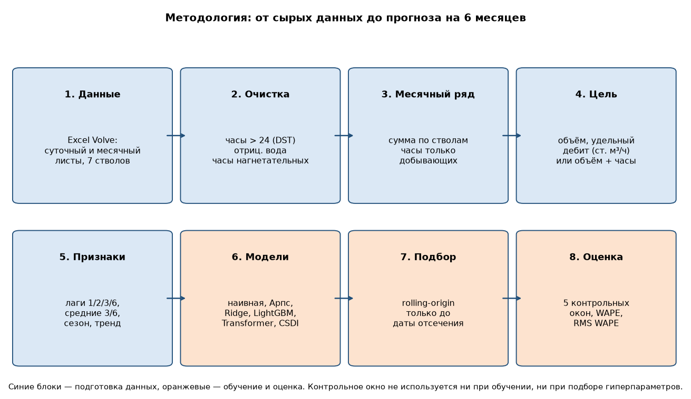

**Подпись.** Последовательность шагов: данные → очистка → месячный ряд → выбор цели → признаки → модели → подбор на истории → оценка на 5 окнах.

### G2. Аномалии исходных данных и их обработка

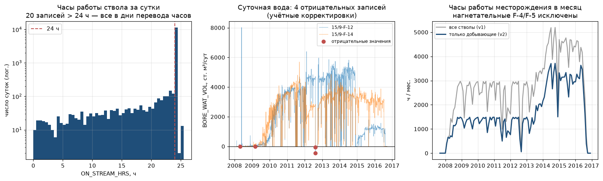

**Подпись.** Слева: суточные часы работы ствола, записи > 24 ч. В центре: отрицательные суточные объёмы воды. Справа: часы месторождения до и после исключения нагнетательных стволов.

### G3. Объём, часы работы и удельный дебит

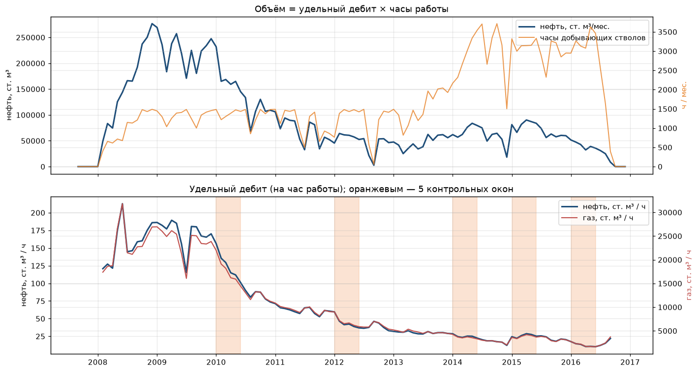

**Подпись.** Сверху: месячная нефть и часы работы добывающих стволов. Снизу: удельный дебит нефти и газа (ст. м³ на час) и 5 контрольных окон.

### G4. Обоснование способа прогноза газа

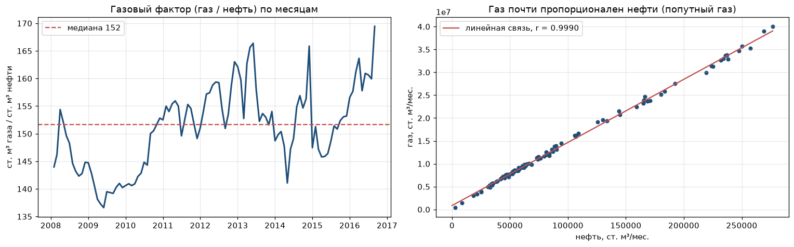

**Подпись.** Слева: газовый фактор по месяцам. Справа: месячный газ против месячной нефти.

### G5. Месячный профиль нефти, контрольное окно 2

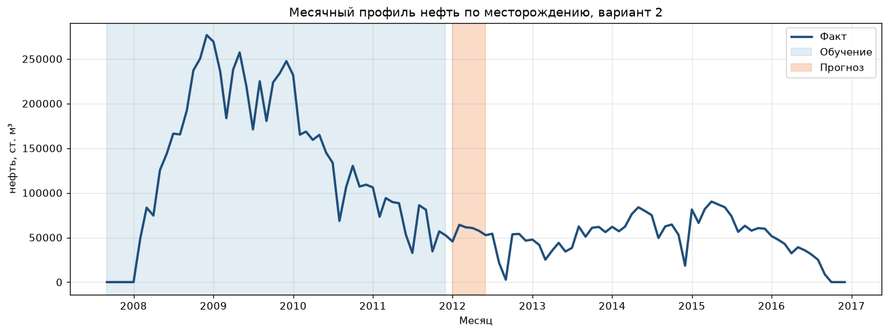

**Подпись.** Месячная добыча нефти по месторождению. Голубая заливка — обучение (до 2011-12), оранжевая — прогноз (2012-01 — 2012-06).

### G6. Месячный профиль газа, контрольное окно 4

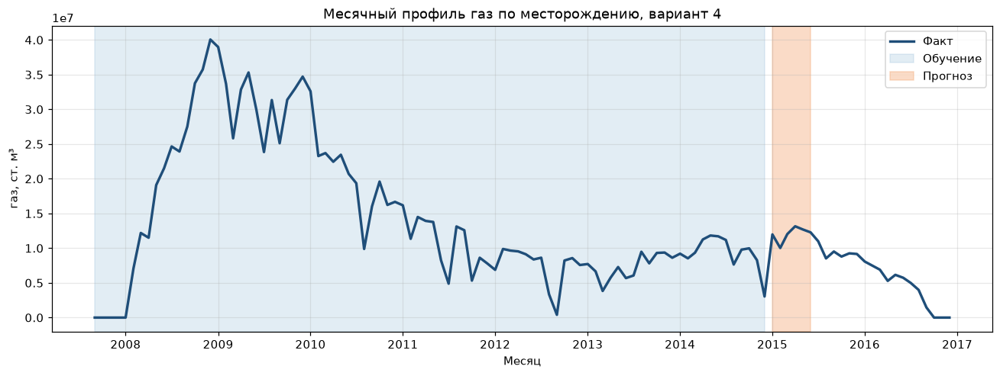

**Подпись.** Месячная добыча газа. Голубая заливка — обучение (до 2014-12), оранжевая — прогноз (2015-01 — 2015-06).

### G7. Кривые падения нефти по стволам

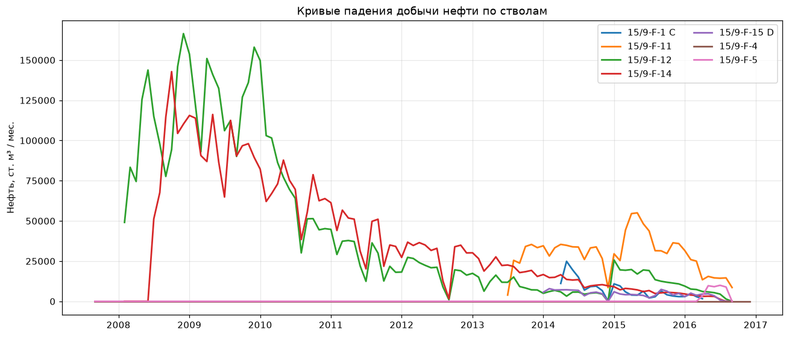

**Подпись.** Месячная добыча нефти отдельно по каждому стволу.

### G8. Декомпозиция ряда нефти

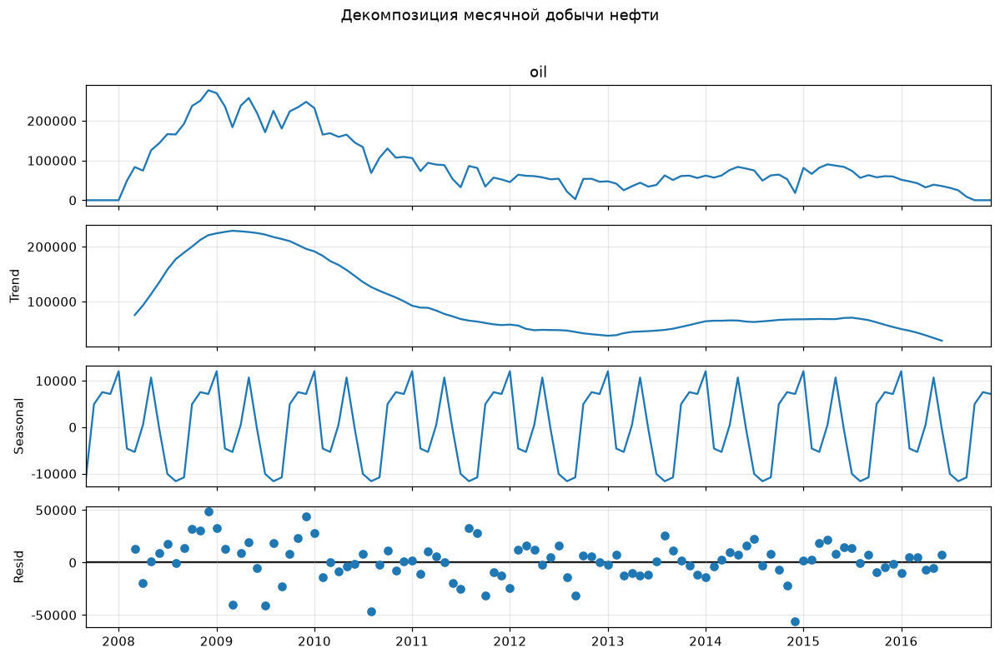

**Подпись.** Аддитивное разложение: наблюдение, тренд, сезонность (12 мес.), остаток.

## Выбор модели и подбор гиперпараметров

### G9. Подбор alpha Ridge на истории до даты отсечения

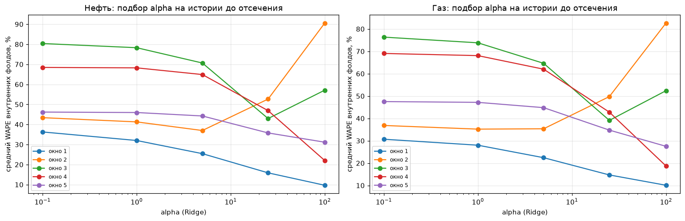

**Подпись.** Средний WAPE трёх внутренних фолдов (rolling origin: отсечение −6, −12, −18 мес., горизонт 6) в зависимости от alpha, по каждому окну.

### G10. Честный подбор против подбора на тесте

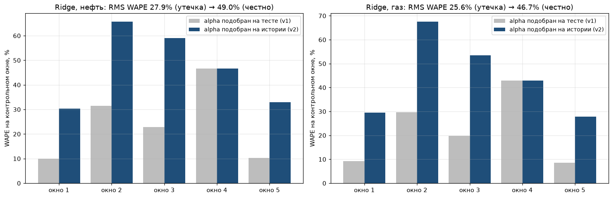

**Подпись.** Ridge по объёму: WAPE на контрольных окнах при alpha, выбранном по тесту (как фактически было в v1), и по внутренней валидации (v2).

### G11. Ошибка на валидации и на контрольном окне

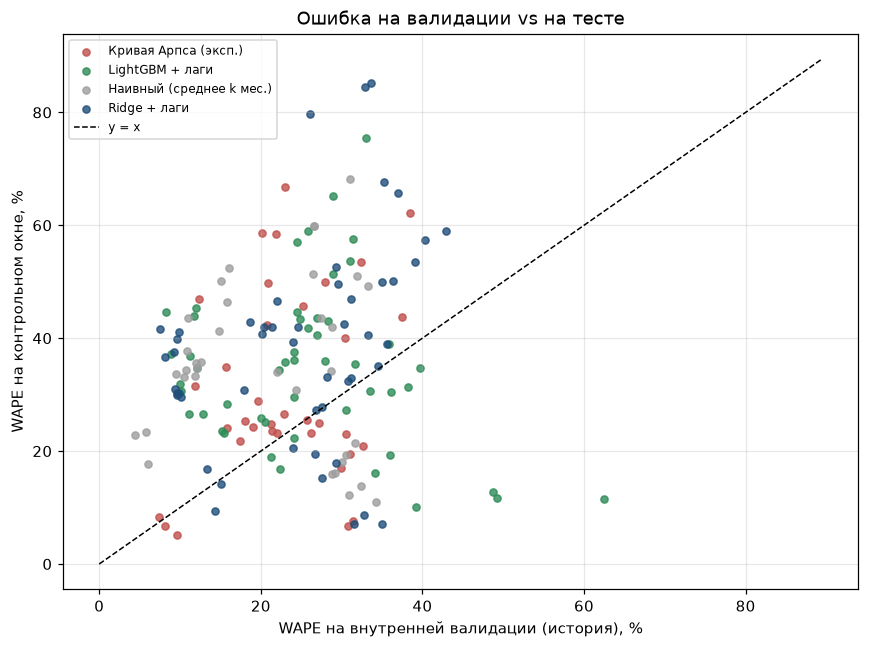

**Подпись.** Каждая точка — подход × окно × флюид: WAPE на внутренней валидации (ось X) и на контрольном окне (ось Y).

### G12. Сравнение ML-подходов: RMS WAPE

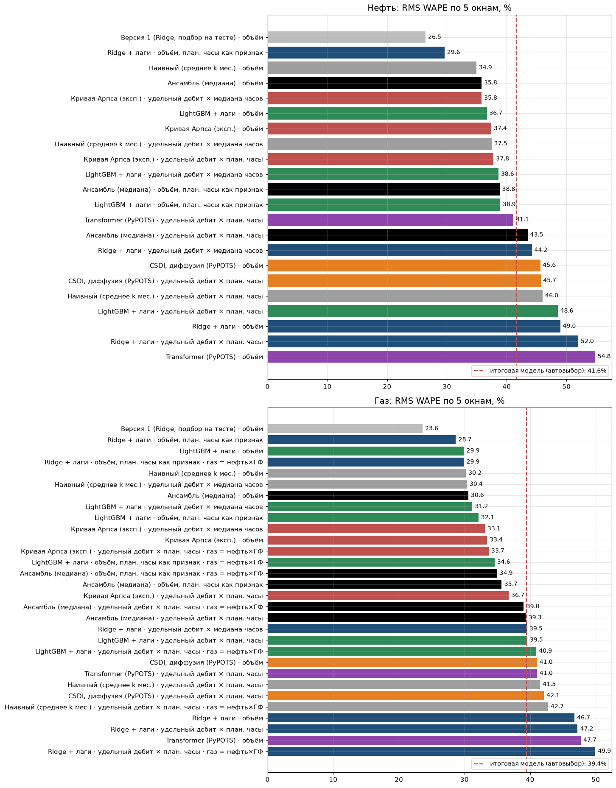

**Подпись.** RMS WAPE по 5 окнам для всех подходов: модель × цель (объём / удельный дебит) × способ прогноза газа. Красная линия — итоговая модель с автовыбором.

### G13. Газ: отдельная модель или множитель к нефти

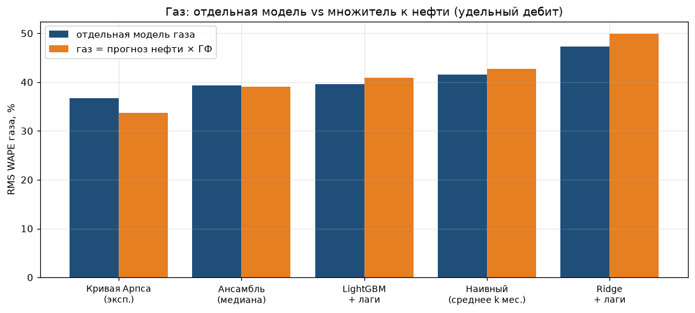

**Подпись.** RMS WAPE газа для двух путей: отдельная модель на ряд газа и прогноз нефти × газовый фактор последних 6 мес. (цель — удельный дебит).

### G14. Нефть: WAPE по окнам для каждого подхода

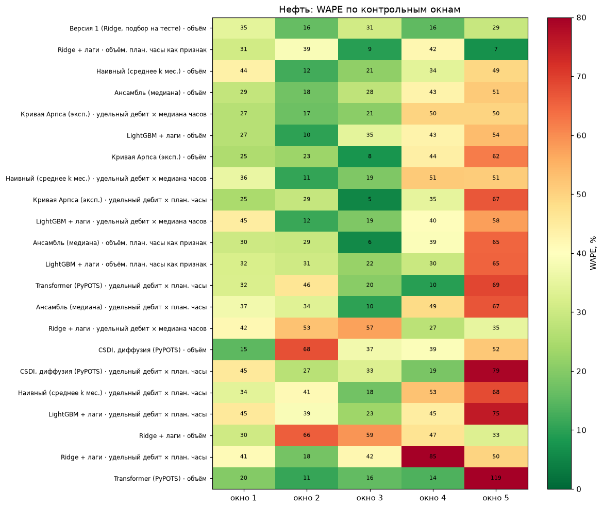

**Подпись.** Тепловая карта WAPE, %: строки — подходы, столбцы — 5 контрольных окон.

### G15. Газ: WAPE по окнам для каждого подхода

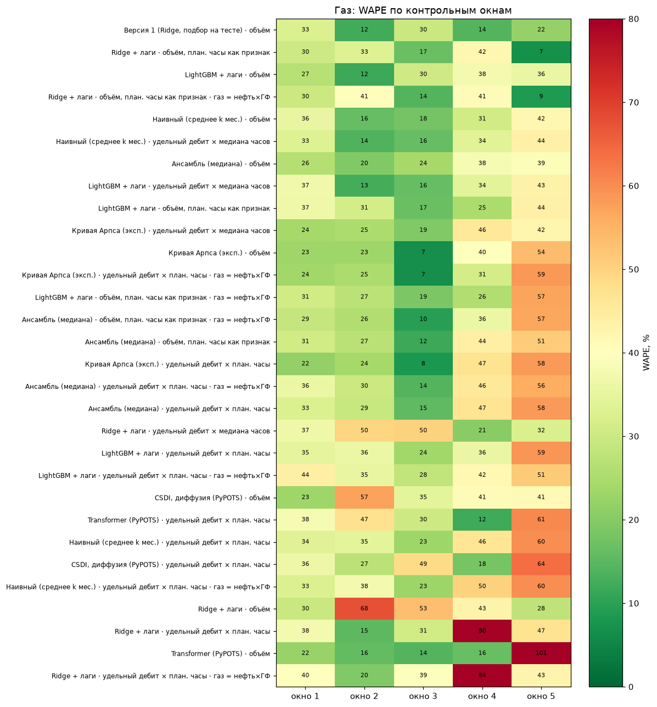

**Подпись.** То же для газа, включая путь «нефть × ГФ».

### G16. Нефть: факт и прогнозы разных подходов по окнам

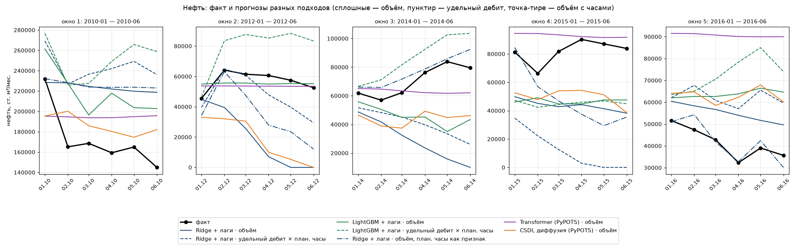

**Подпись.** Сплошные линии — прогноз объёма, пунктир — удельный дебит × плановые часы, точки-тире — объём с плановыми часами как признаком. Цвет — модель.

### G17. Газ: факт и прогнозы разных подходов по окнам

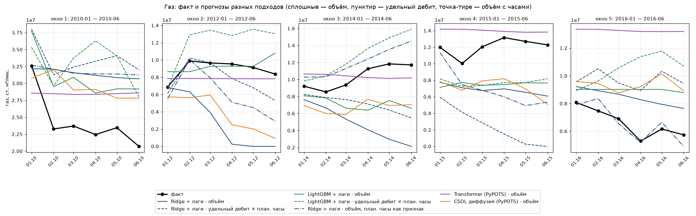

**Подпись.** То же для газа.

## Итоговая модель: прогноз и ошибки по окнам

### G18. Нефть, окно 2: факт, Арпс и итоговая модель

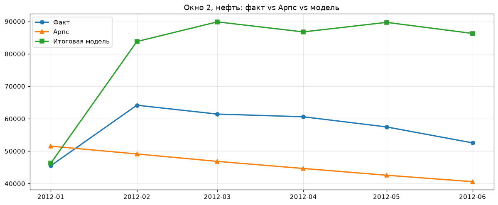

**Подпись.** Факт, кривая Арпса (baseline) и итоговая модель на 2012 H1.

### G19. Скважина 15/9-F-12, 2015 H1

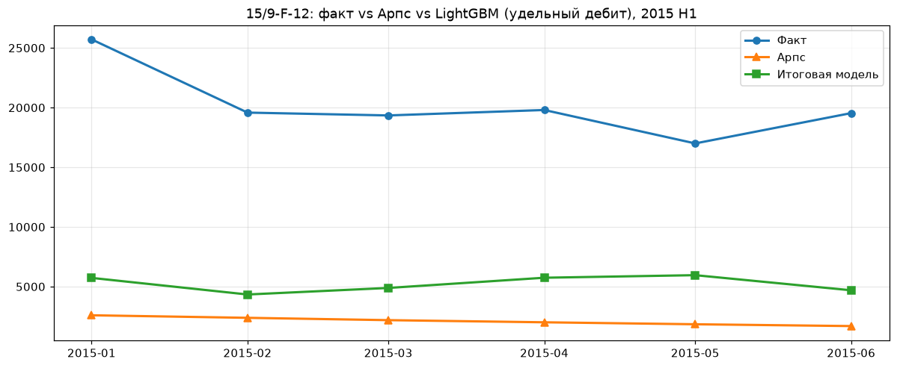

**Подпись.** Тот же протокол, что окно 4, но для одного ствола F-12.

## Окно 1 · нефть · 2010-01 — 2010-06

### G20. Нефть, окно 1: факт и прогноз

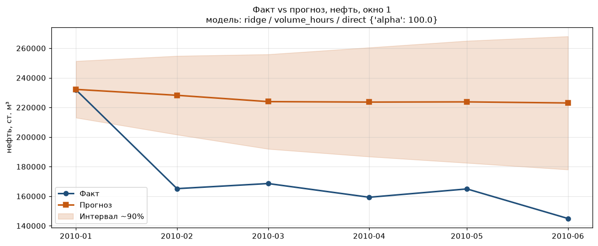

**Подпись.** Факт, прогноз итоговой модели и интервал ~90% (2010-01 — 2010-06). Модель выбрана внутренней валидацией: ridge, цель volume_hours, газ: direct.

### G21. Нефть, окно 1: абсолютная ошибка

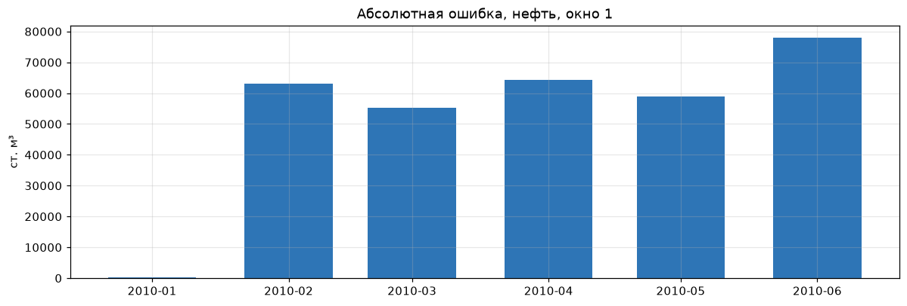

**Подпись.** |факт − прогноз|, ст. м³ / мес.

### G22. Нефть, окно 1: относительная ошибка

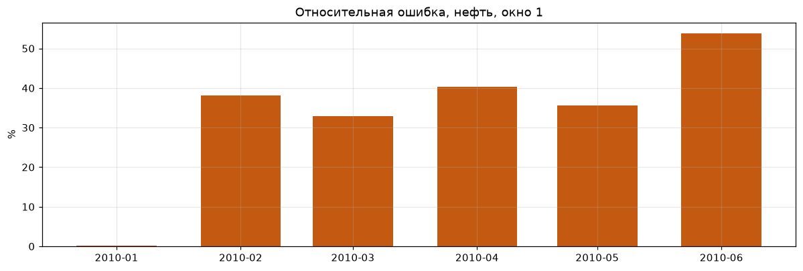

**Подпись.** |факт − прогноз| / |факт| × 100%.

## Окно 1 · газ · 2010-01 — 2010-06

### G23. Газ, окно 1: факт и прогноз

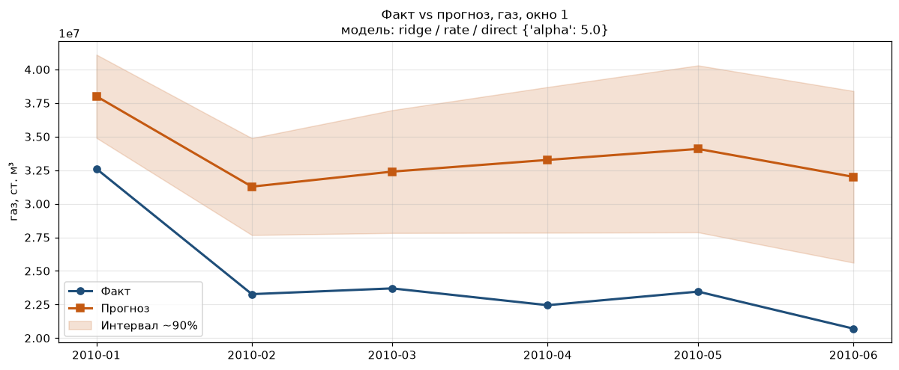

**Подпись.** Факт, прогноз итоговой модели и интервал ~90% (2010-01 — 2010-06). Модель выбрана внутренней валидацией: ridge, цель rate, газ: direct.

### G24. Газ, окно 1: абсолютная ошибка

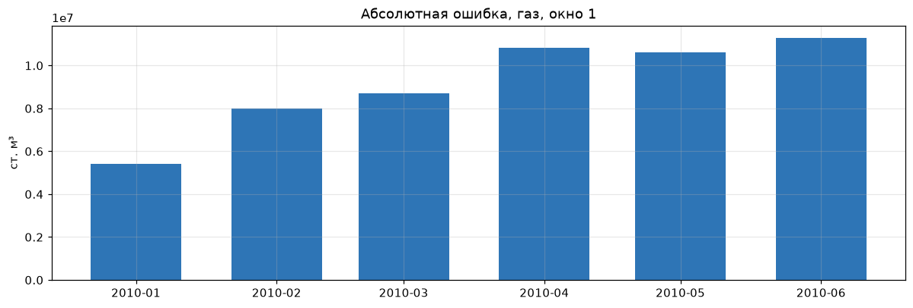

**Подпись.** |факт − прогноз|, ст. м³ / мес.

### G25. Газ, окно 1: относительная ошибка

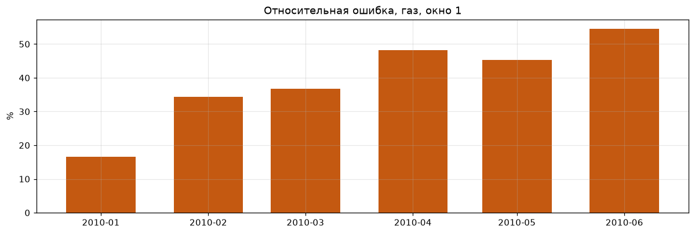

**Подпись.** |факт − прогноз| / |факт| × 100%.

## Окно 2 · нефть · 2012-01 — 2012-06

### G26. Нефть, окно 2: факт и прогноз

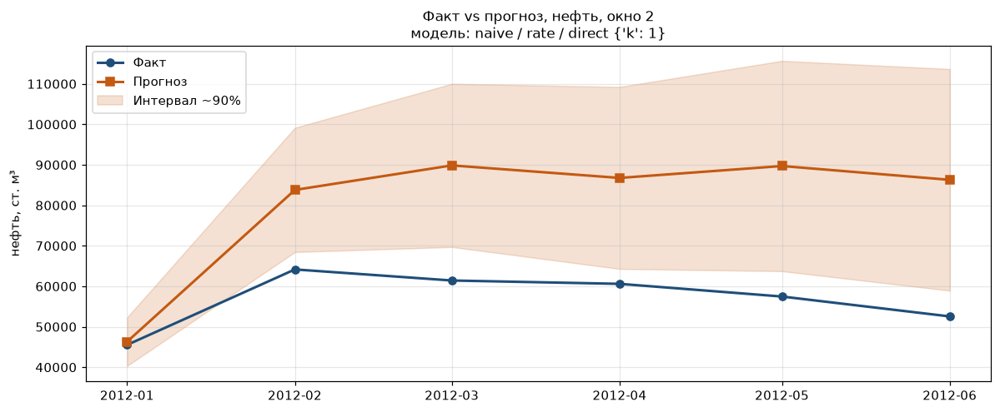

**Подпись.** Факт, прогноз итоговой модели и интервал ~90% (2012-01 — 2012-06). Модель выбрана внутренней валидацией: naive, цель rate, газ: direct.

### G27. Нефть, окно 2: абсолютная ошибка

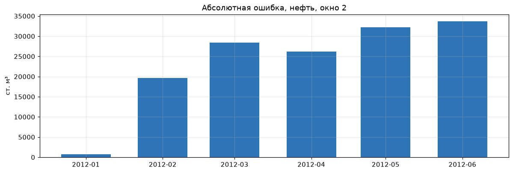

**Подпись.** |факт − прогноз|, ст. м³ / мес.

### G28. Нефть, окно 2: относительная ошибка

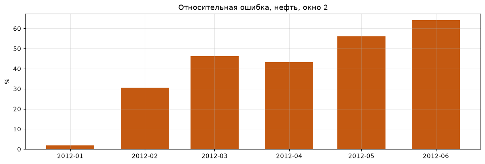

**Подпись.** |факт − прогноз| / |факт| × 100%.

## Окно 2 · газ · 2012-01 — 2012-06

### G29. Газ, окно 2: факт и прогноз

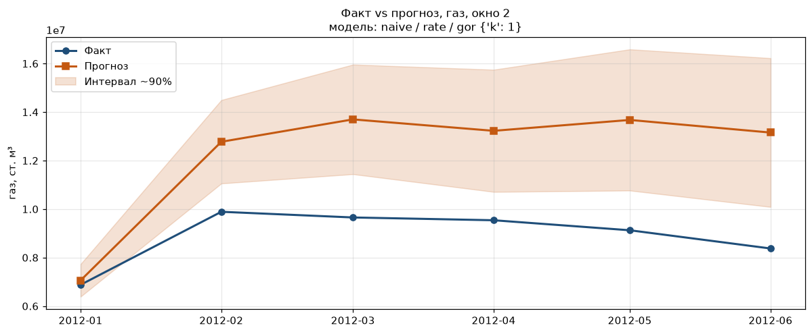

**Подпись.** Факт, прогноз итоговой модели и интервал ~90% (2012-01 — 2012-06). Модель выбрана внутренней валидацией: naive, цель rate, газ: gor.

### G30. Газ, окно 2: абсолютная ошибка

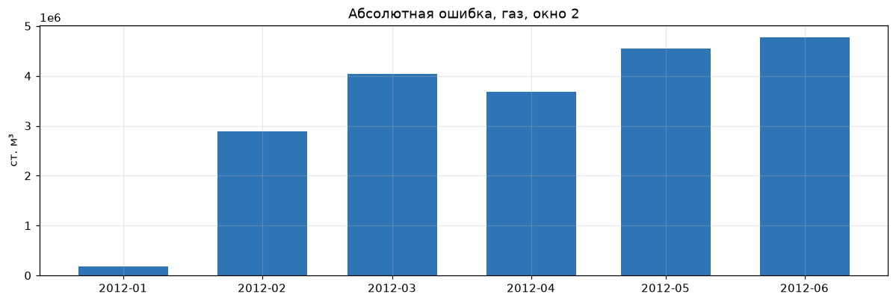

**Подпись.** |факт − прогноз|, ст. м³ / мес.

### G31. Газ, окно 2: относительная ошибка

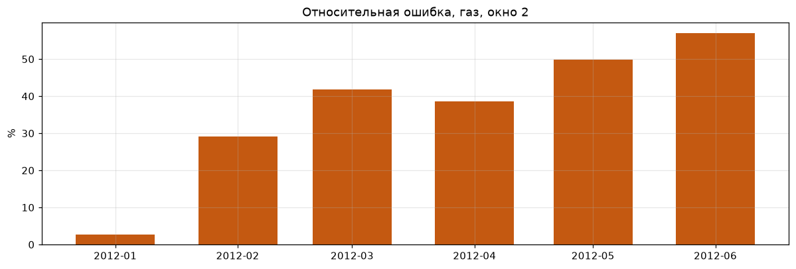

**Подпись.** |факт − прогноз| / |факт| × 100%.

## Окно 3 · нефть · 2014-01 — 2014-06

### G32. Нефть, окно 3: факт и прогноз

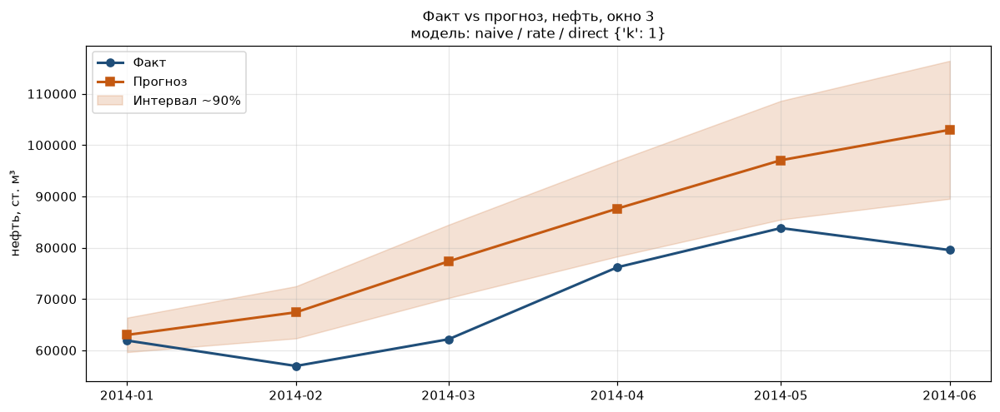

**Подпись.** Факт, прогноз итоговой модели и интервал ~90% (2014-01 — 2014-06). Модель выбрана внутренней валидацией: naive, цель rate, газ: direct.

### G33. Нефть, окно 3: абсолютная ошибка

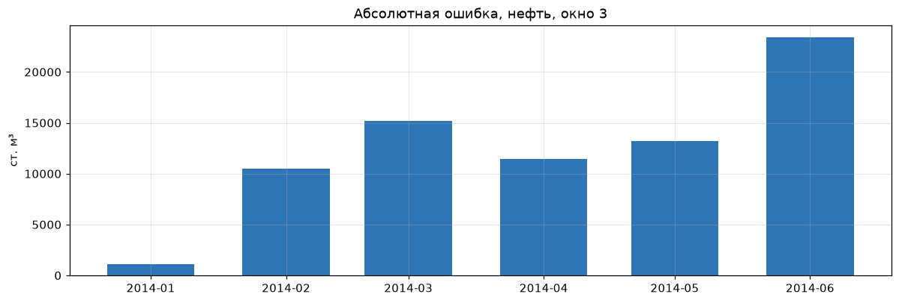

**Подпись.** |факт − прогноз|, ст. м³ / мес.

### G34. Нефть, окно 3: относительная ошибка

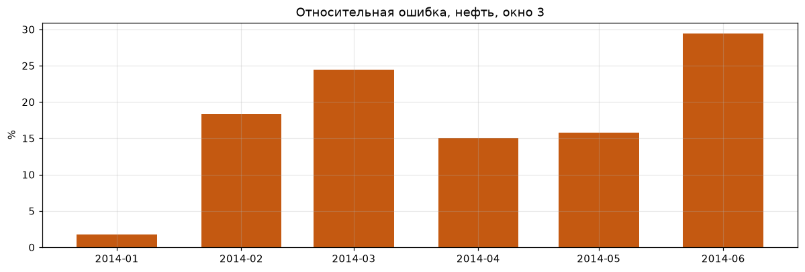

**Подпись.** |факт − прогноз| / |факт| × 100%.

## Окно 3 · газ · 2014-01 — 2014-06

### G35. Газ, окно 3: факт и прогноз

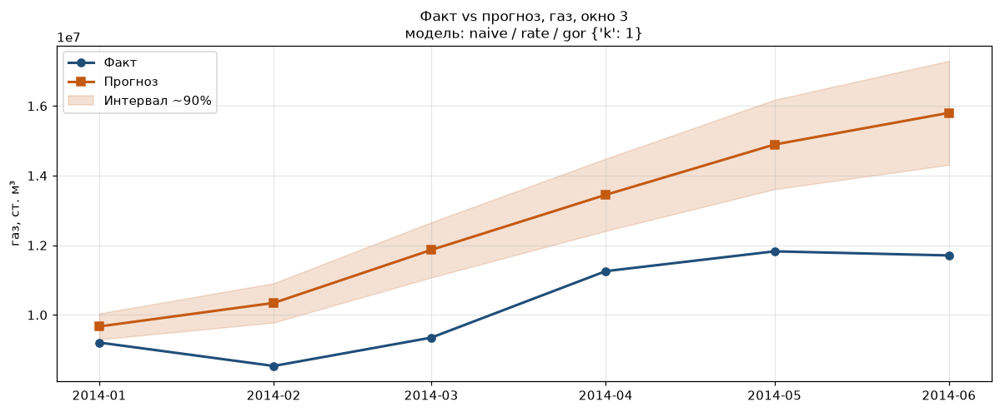

**Подпись.** Факт, прогноз итоговой модели и интервал ~90% (2014-01 — 2014-06). Модель выбрана внутренней валидацией: naive, цель rate, газ: gor.

### G36. Газ, окно 3: абсолютная ошибка

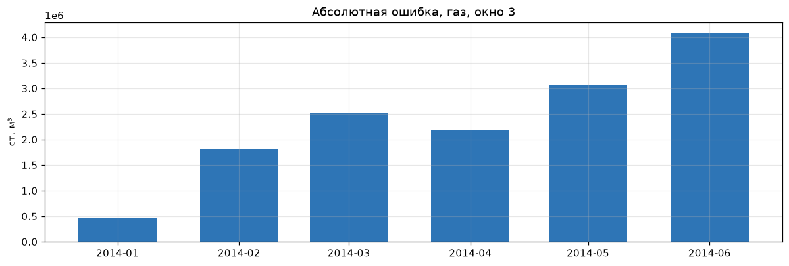

**Подпись.** |факт − прогноз|, ст. м³ / мес.

### G37. Газ, окно 3: относительная ошибка

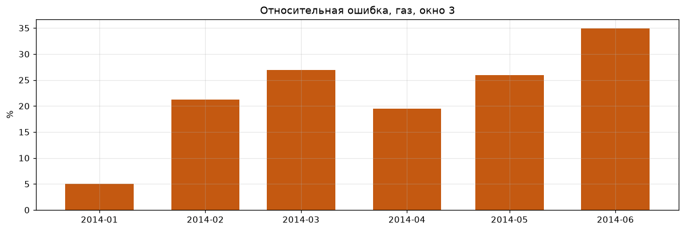

**Подпись.** |факт − прогноз| / |факт| × 100%.

## Окно 4 · нефть · 2015-01 — 2015-06

### G38. Нефть, окно 4: факт и прогноз

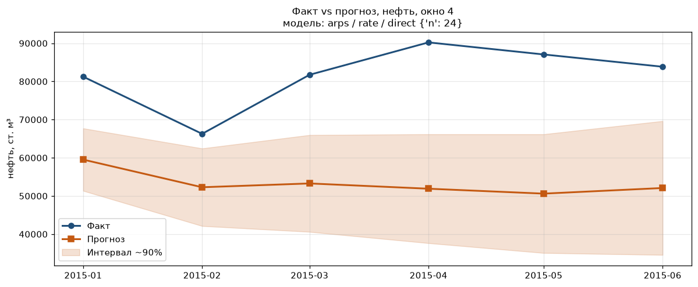

**Подпись.** Факт, прогноз итоговой модели и интервал ~90% (2015-01 — 2015-06). Модель выбрана внутренней валидацией: arps, цель rate, газ: direct.

### G39. Нефть, окно 4: абсолютная ошибка

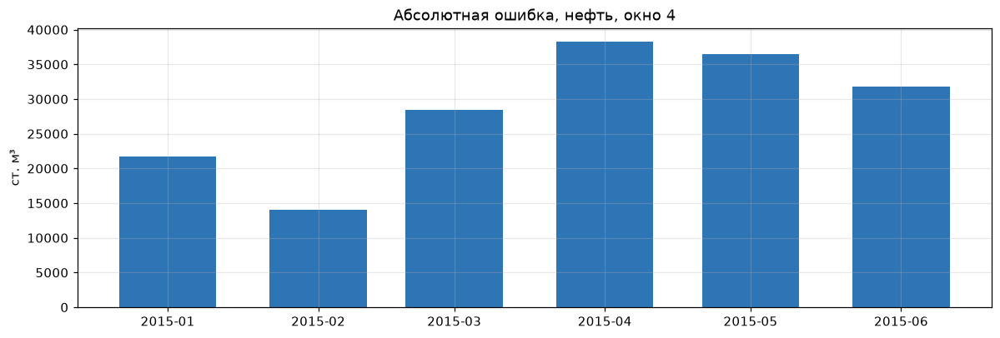

**Подпись.** |факт − прогноз|, ст. м³ / мес.

### G40. Нефть, окно 4: относительная ошибка

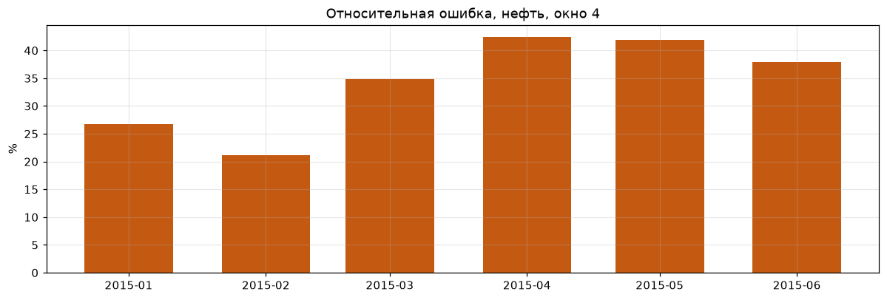

**Подпись.** |факт − прогноз| / |факт| × 100%.

## Окно 4 · газ · 2015-01 — 2015-06

### G41. Газ, окно 4: факт и прогноз

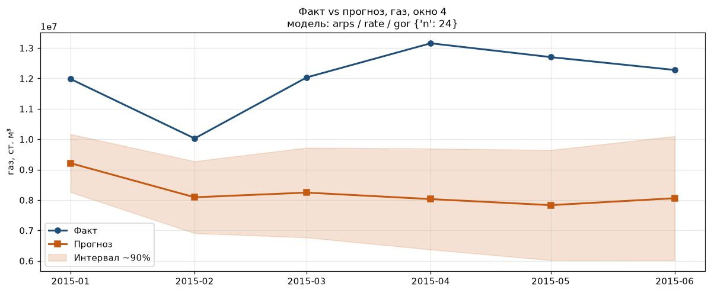

**Подпись.** Факт, прогноз итоговой модели и интервал ~90% (2015-01 — 2015-06). Модель выбрана внутренней валидацией: arps, цель rate, газ: gor.

### G42. Газ, окно 4: абсолютная ошибка

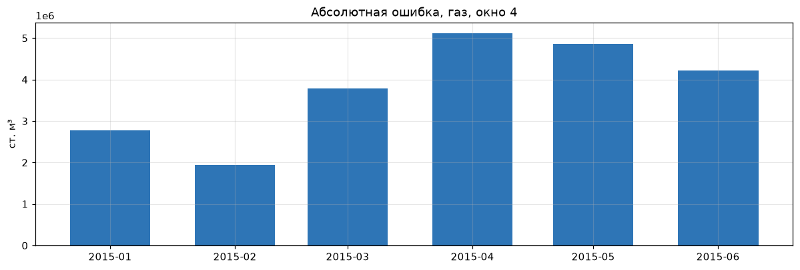

**Подпись.** |факт − прогноз|, ст. м³ / мес.

### G43. Газ, окно 4: относительная ошибка

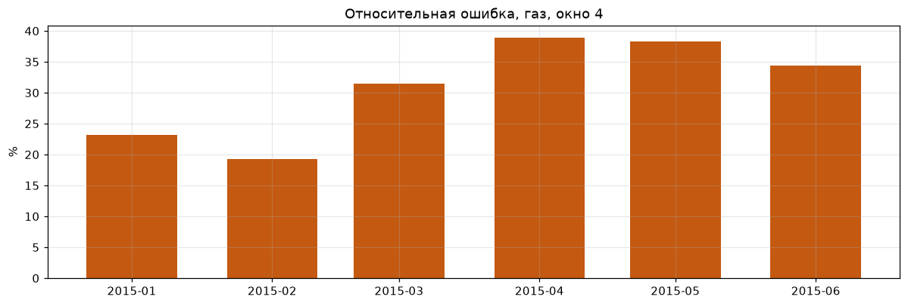

**Подпись.** |факт − прогноз| / |факт| × 100%.

## Окно 5 · нефть · 2016-01 — 2016-06

### G44. Нефть, окно 5: факт и прогноз

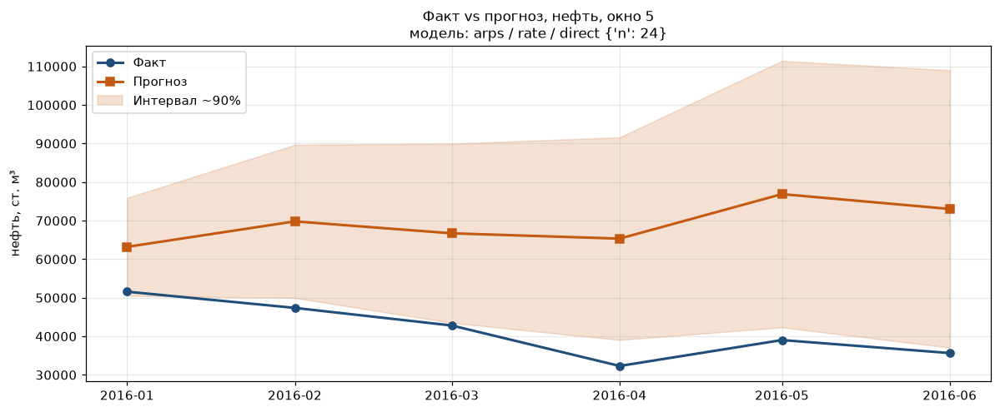

**Подпись.** Факт, прогноз итоговой модели и интервал ~90% (2016-01 — 2016-06). Модель выбрана внутренней валидацией: arps, цель rate, газ: direct.

### G45. Нефть, окно 5: абсолютная ошибка

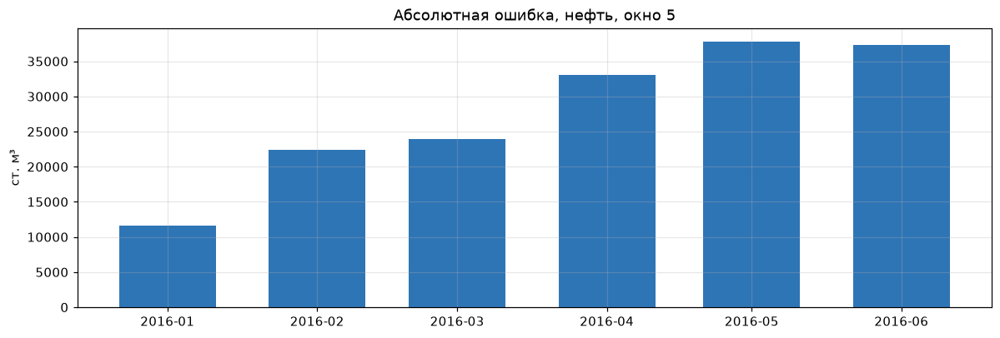

**Подпись.** |факт − прогноз|, ст. м³ / мес.

### G46. Нефть, окно 5: относительная ошибка

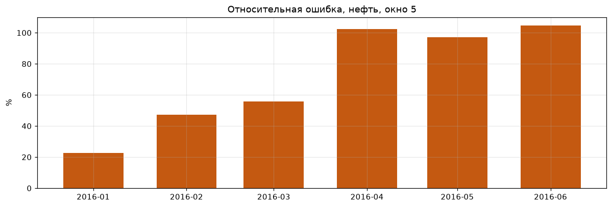

**Подпись.** |факт − прогноз| / |факт| × 100%.

## Окно 5 · газ · 2016-01 — 2016-06

### G47. Газ, окно 5: факт и прогноз

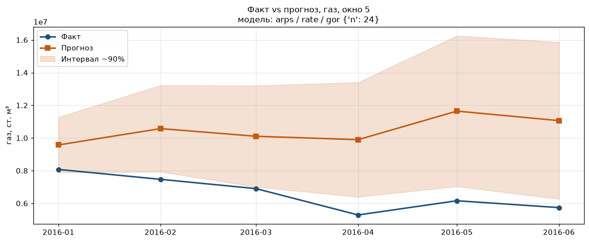

**Подпись.** Факт, прогноз итоговой модели и интервал ~90% (2016-01 — 2016-06). Модель выбрана внутренней валидацией: arps, цель rate, газ: gor.

### G48. Газ, окно 5: абсолютная ошибка

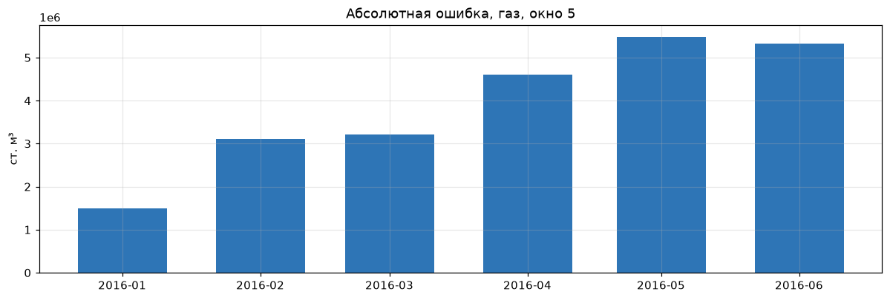

**Подпись.** |факт − прогноз|, ст. м³ / мес.

### G49. Газ, окно 5: относительная ошибка

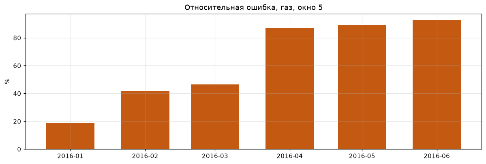

**Подпись.** |факт − прогноз| / |факт| × 100%.

## Легенда

### G1

- **Название.** Схема методологии
- **Файл.** `figures/methodology_pipeline.png`
- **Обоснование.** Комментарий наставника: в итоговом отчёте подробно описать, как данные предобрабатываются и что с ними происходит дальше.
- **Описание.** Синие блоки — подготовка данных, оранжевые — обучение и оценка. Контрольное окно не участвует ни в обучении, ни в подборе гиперпараметров.

### G2

- **Название.** Аномалии исходных данных и их обработка
- **Файл.** `figures/preprocessing.png`
- **Обоснование.** Вопрос наставника: куда делись отрицательные объёмы воды и скважины, работавшие больше 24 часов за сутки.
- **Описание.** Все 20 записей с часами > 24 (до 25 ч) приходятся на последнее воскресенье октября — переход на зимнее время, сутки реально длились 25 ч, значения оставлены. 4 отрицательных значения воды (F-12, F-14; 2008-04-23, 2009-03-03, 2012-08-13) — учётные корректировки аллокации; месячный лист уже содержит их свёрнутыми в сумму (расхождение суток и месяцев 0), отрицательных месячных объёмов нет. Нагнетательные F-4/F-5 давали до ~1 500 ч/мес. «рабочих» часов без добычи — в v1 они завышали часы месторождения; в v2 считаются только часы добывающих стволов.

### G3

- **Название.** Объём, часы работы и удельный дебит
- **Файл.** `figures/rate_series.png`
- **Обоснование.** Комментарий наставника: проверить постановку «удельный дебит на час работы» — часы являются плановой величиной.
- **Описание.** Провалы объёма (простои 2010-08, 2012-09, 2014-12) почти исчезают в удельном дебите: это шум часов, а не пласта. Остаётся медленное падение и скачки при вводе F-11 (2013) и F-1 C/F-15 D (2014).

### G4

- **Название.** Обоснование способа прогноза газа
- **Файл.** `figures/gor_justification.png`
- **Обоснование.** Комментарий наставника: отдельная модель на газ вместо множителя к нефти требует обоснования.
- **Описание.** Газ на Volve — попутный: корреляция с нефтью почти 1, газовый фактор держится в узком коридоре ~140–170 ст. м³/ст. м³ и медленно растёт. Поэтому сравниваются оба пути — отдельная модель газа и «прогноз нефти × ГФ» (см. G13).

### G5

- **Название.** Месячный профиль нефти, контрольное окно 2
- **Файл.** `figures/profile_oil_window2.png`
- **Обоснование.** Прямое требование кейса: профиль нефти с выделенным контрольным окном варианта 2.
- **Описание.** Синяя линия — сумма по стволам. Видно падение после пика 2008–2009 и провалы-простои.

### G6

- **Название.** Месячный профиль газа, контрольное окно 4
- **Файл.** `figures/profile_gas_window4.png`
- **Обоснование.** Прямое требование кейса: то же для газа, вариант 4.
- **Описание.** На хвосте обучения — провал декабря 2014 (простой): для модели объёма это ловушка, для модели удельного дебита — нет.

### G7

- **Название.** Кривые падения нефти по стволам
- **Файл.** `figures/wells_oil_decline.png`
- **Обоснование.** Задача 2: кривая падения не только по полю, но и по скважинам.
- **Описание.** F-12 и F-14 несут основную добычу; F-11, F-1 C, F-15 D входят позже и ломают гладкое падение суммы.

### G8

- **Название.** Декомпозиция ряда нефти
- **Файл.** `figures/stl_oil.png`
- **Обоснование.** Задача 2: обоснование признаков (тренд, календарь, лаги).
- **Описание.** Сезонность слаба по сравнению с трендом и остатком — поэтому календарь кодируется только sin/cos месяца, без сезонных моделей.

### G9

- **Название.** Подбор alpha Ridge на истории до даты отсечения
- **Файл.** `figures/tuning_ridge_alpha.png`
- **Обоснование.** Комментарий наставника: модель тюнилась на тех же данных, на которых оценивалась точность.
- **Описание.** Гиперпараметры выбираются минимумом этой кривой; контрольное окно в расчёт не входит. Аналогичные сетки — для LightGBM (12 комбинаций), Арпса (длина хвоста 12/18/24) и наивной модели (k = 1/3/6).

### G10

- **Название.** Честный подбор против подбора на тесте
- **Файл.** `figures/tuning_leakage.png`
- **Обоснование.** Количественно показать, насколько оптимистична оценка при подборе на тестовых данных.
- **Описание.** Нефть: RMS WAPE 27.9% при подборе на тесте против 49.0% при честном подборе; газ: 25.6% против 46.7%. Разница — это «утечка» оценки: прежние ~25% были занижены.

### G11

- **Название.** Ошибка на валидации и на контрольном окне
- **Файл.** `figures/inner_vs_test.png`
- **Обоснование.** Показать, насколько внутренняя валидация предсказывает реальную ошибку.
- **Описание.** Большинство точек выше диагонали: будущие 6 месяцев сложнее прошлых (ввод скважин, резкое падение 2016). Внутренняя валидация полезна для ранжирования, но занижает абсолютную ошибку.

### G12

- **Название.** Сравнение ML-подходов: RMS WAPE
- **Файл.** `figures/model_comparison.png`
- **Обоснование.** Комментарий наставника: сравнить несколько ML-подходов, заменить регрессию на бустинг, посмотреть трансформеры и диффузионные модели (PyPOTS).
- **Описание.** Лучший подход по нефти — v1 / volume (26.5%), по газу — v1 / volume (23.6%). LightGBM вместо Ridge по объёму: нефть 49.0% → 36.7%, газ 46.7% → 29.9%. Transformer (PyPOTS) по объёму: нефть 54.8%, газ 47.7%; CSDI (диффузия): нефть 45.6%, газ 41.0%. Выбор лучшего по этой диаграмме — снова подгонка под тест, поэтому итоговая модель выбирается автоматически по внутренней валидации.

### G13

- **Название.** Газ: отдельная модель или множитель к нефти
- **Файл.** `figures/gas_direct_vs_gor.png`
- **Обоснование.** Обоснование отдельной модели газа (комментарий наставника).
- **Описание.** Пути дают близкую точность, т.к. ГФ стабилен. Итоговая модель выбирает путь в каждом окне по внутренней валидации; множитель проще, физически согласован с нефтью и не даёт газу «разойтись» с нефтью.

### G14

- **Название.** Нефть: WAPE по окнам для каждого подхода
- **Файл.** `figures/heatmap_oil.png`
- **Обоснование.** Показать, что ни один подход не лучший во всех окнах.
- **Описание.** Окно 3 (ввод F-1 C/F-15 D) и окно 5 (резкое падение дебита 2016) трудны для всех моделей: информации о вводе скважин и ГТМ в истории нет.

### G15

- **Название.** Газ: WAPE по окнам для каждого подхода
- **Файл.** `figures/heatmap_gas.png`
- **Обоснование.** См. G14.
- **Описание.** Картина повторяет нефть — следствие пропорциональности газа и нефти.

### G16

- **Название.** Нефть: факт и прогнозы разных подходов по окнам
- **Файл.** `figures/windows_models_oil.png`
- **Обоснование.** Визуальное сравнение Ridge, LightGBM, Transformer и CSDI.
- **Описание.** Синий сплошной (Ridge) против синего пунктира (Ridge на удельном дебите). Удельный дебит хорошо отрабатывает простои в прогнозном периоде (они приходят через плановые часы), но переносит в будущее уровень дебита последних месяцев.

### G17

- **Название.** Газ: факт и прогнозы разных подходов по окнам
- **Файл.** `figures/windows_models_gas.png`
- **Обоснование.** См. G16.

### G18

- **Название.** Нефть, окно 2: факт, Арпс и итоговая модель
- **Файл.** `figures/window2_oil_arps_vs_ml.png`
- **Обоснование.** Кейс и задача 2: сравнение с Арпсом.

### G19

- **Название.** Скважина 15/9-F-12, 2015 H1
- **Файл.** `figures/well_f12_2015.png`
- **Обоснование.** Задача 2: скважинный взгляд.

### G20

- **Название.** Нефть, окно 1: факт и прогноз
- **Файл.** `figures/w1_oil_fact_pred.png`
- **Обоснование.** Требование кейса: факт vs прогноз по каждому окну.
- **Описание.** WAPE 30.9% (на внутренней валидации было 9.4%).

### G21

- **Название.** Нефть, окно 1: абсолютная ошибка
- **Файл.** `figures/w1_oil_abs.png`
- **Обоснование.** Требование кейса: абсолютная ошибка по месяцам.

### G22

- **Название.** Нефть, окно 1: относительная ошибка
- **Файл.** `figures/w1_oil_rel.png`
- **Обоснование.** Требование кейса: относительная ошибка по месяцам.

### G23

- **Название.** Газ, окно 1: факт и прогноз
- **Файл.** `figures/w1_gas_fact_pred.png`
- **Обоснование.** Требование кейса: факт vs прогноз по каждому окну.
- **Описание.** WAPE 37.5% (на внутренней валидации было 9.3%).

### G24

- **Название.** Газ, окно 1: абсолютная ошибка
- **Файл.** `figures/w1_gas_abs.png`
- **Обоснование.** Требование кейса: абсолютная ошибка по месяцам.

### G25

- **Название.** Газ, окно 1: относительная ошибка
- **Файл.** `figures/w1_gas_rel.png`
- **Обоснование.** Требование кейса: относительная ошибка по месяцам.

### G26

- **Название.** Нефть, окно 2: факт и прогноз
- **Файл.** `figures/w2_oil_fact_pred.png`
- **Обоснование.** Требование кейса: факт vs прогноз по каждому окну.
- **Описание.** WAPE 41.3% (на внутренней валидации было 14.8%).

### G27

- **Название.** Нефть, окно 2: абсолютная ошибка
- **Файл.** `figures/w2_oil_abs.png`
- **Обоснование.** Требование кейса: абсолютная ошибка по месяцам.

### G28

- **Название.** Нефть, окно 2: относительная ошибка
- **Файл.** `figures/w2_oil_rel.png`
- **Обоснование.** Требование кейса: относительная ошибка по месяцам.

### G29

- **Название.** Газ, окно 2: факт и прогноз
- **Файл.** `figures/w2_gas_fact_pred.png`
- **Обоснование.** Требование кейса: факт vs прогноз по каждому окну.
- **Описание.** WAPE 37.6% (на внутренней валидации было 10.9%).

### G30

- **Название.** Газ, окно 2: абсолютная ошибка
- **Файл.** `figures/w2_gas_abs.png`
- **Обоснование.** Требование кейса: абсолютная ошибка по месяцам.

### G31

- **Название.** Газ, окно 2: относительная ошибка
- **Файл.** `figures/w2_gas_rel.png`
- **Обоснование.** Требование кейса: относительная ошибка по месяцам.

### G32

- **Название.** Нефть, окно 3: факт и прогноз
- **Файл.** `figures/w3_oil_fact_pred.png`
- **Обоснование.** Требование кейса: факт vs прогноз по каждому окну.
- **Описание.** WAPE 17.8% (на внутренней валидации было 6.1%).

### G33

- **Название.** Нефть, окно 3: абсолютная ошибка
- **Файл.** `figures/w3_oil_abs.png`
- **Обоснование.** Требование кейса: абсолютная ошибка по месяцам.

### G34

- **Название.** Нефть, окно 3: относительная ошибка
- **Файл.** `figures/w3_oil_rel.png`
- **Обоснование.** Требование кейса: относительная ошибка по месяцам.

### G35

- **Название.** Газ, окно 3: факт и прогноз
- **Файл.** `figures/w3_gas_fact_pred.png`
- **Обоснование.** Требование кейса: факт vs прогноз по каждому окну.
- **Описание.** WAPE 22.9% (на внутренней валидации было 4.4%).

### G36

- **Название.** Газ, окно 3: абсолютная ошибка
- **Файл.** `figures/w3_gas_abs.png`
- **Обоснование.** Требование кейса: абсолютная ошибка по месяцам.

### G37

- **Название.** Газ, окно 3: относительная ошибка
- **Файл.** `figures/w3_gas_rel.png`
- **Обоснование.** Требование кейса: относительная ошибка по месяцам.

### G38

- **Название.** Нефть, окно 4: факт и прогноз
- **Файл.** `figures/w4_oil_fact_pred.png`
- **Обоснование.** Требование кейса: факт vs прогноз по каждому окну.
- **Описание.** WAPE 34.8% (на внутренней валидации было 15.7%).

### G39

- **Название.** Нефть, окно 4: абсолютная ошибка
- **Файл.** `figures/w4_oil_abs.png`
- **Обоснование.** Требование кейса: абсолютная ошибка по месяцам.

### G40

- **Название.** Нефть, окно 4: относительная ошибка
- **Файл.** `figures/w4_oil_rel.png`
- **Обоснование.** Требование кейса: относительная ошибка по месяцам.

### G41

- **Название.** Газ, окно 4: факт и прогноз
- **Файл.** `figures/w4_gas_fact_pred.png`
- **Обоснование.** Требование кейса: факт vs прогноз по каждому окну.
- **Описание.** WAPE 31.5% (на внутренней валидации было 11.8%).

### G42

- **Название.** Газ, окно 4: абсолютная ошибка
- **Файл.** `figures/w4_gas_abs.png`
- **Обоснование.** Требование кейса: абсолютная ошибка по месяцам.

### G43

- **Название.** Газ, окно 4: относительная ошибка
- **Файл.** `figures/w4_gas_rel.png`
- **Обоснование.** Требование кейса: относительная ошибка по месяцам.

### G44

- **Название.** Нефть, окно 5: факт и прогноз
- **Файл.** `figures/w5_oil_fact_pred.png`
- **Обоснование.** Требование кейса: факт vs прогноз по каждому окну.
- **Описание.** WAPE 66.8% (на внутренней валидации было 22.9%).

### G45

- **Название.** Нефть, окно 5: абсолютная ошибка
- **Файл.** `figures/w5_oil_abs.png`
- **Обоснование.** Требование кейса: абсолютная ошибка по месяцам.

### G46

- **Название.** Нефть, окно 5: относительная ошибка
- **Файл.** `figures/w5_oil_rel.png`
- **Обоснование.** Требование кейса: относительная ошибка по месяцам.

### G47

- **Название.** Газ, окно 5: факт и прогноз
- **Файл.** `figures/w5_gas_fact_pred.png`
- **Обоснование.** Требование кейса: факт vs прогноз по каждому окну.
- **Описание.** WAPE 58.6% (на внутренней валидации было 20.2%).

### G48

- **Название.** Газ, окно 5: абсолютная ошибка
- **Файл.** `figures/w5_gas_abs.png`
- **Обоснование.** Требование кейса: абсолютная ошибка по месяцам.

### G49

- **Название.** Газ, окно 5: относительная ошибка
- **Файл.** `figures/w5_gas_rel.png`
- **Обоснование.** Требование кейса: относительная ошибка по месяцам.
